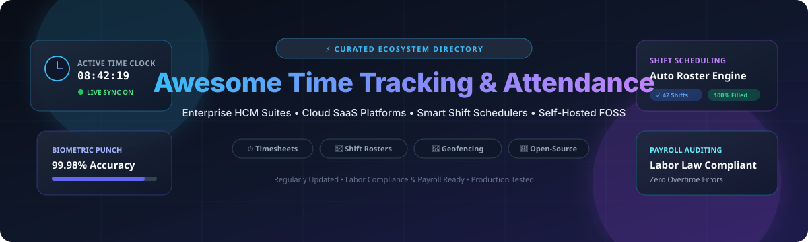

  

  
  
  
  
  
  
  

---

# ⏱️ Awesome Time Tracking & Attendance

> **The definitive, curated landscape of enterprise HCM software, cloud SaaS platforms, automated shift schedulers, and sovereign open-source time-tracking infrastructure.**

Welcome to **Awesome Time Tracking & Attendance**! This repository tracks premier commercial **SaaS platforms** and self-hosted **open-source GitHub projects** engineered to capture employee work hours, coordinate complex shift rosters, prevent buddy punching with biometrics, calculate overtime and rest compliance, and export payroll-ready audit trails.

Whether you are an HR operations leader replacing legacy punch clocks, an enterprise CTO architecting self-hosted workforce compliance stacks, or an independent developer looking for the best automated timekeeper, this guide provides actionable intelligence on pricing, free tiers, star ratings, and deployment models.

---

## 📑 Table of Contents

- [📊 Sector Overview & Market Dynamics](#-sector-overview--market-dynamics)
- [🏢 SaaS & Enterprise Cloud Platforms](#-saas--enterprise-cloud-platforms)
- [🚀 Top Open-Source GitHub Projects](#-top-open-source-github-projects)
  - [⭐ Tier-1 Starred Projects](#-tier-1-starred-projects)
  - [🧩 Specialized Attendance Libraries & Plugins](#-specialized-attendance-libraries--plugins)
- [⚖️ Architectural Decision Matrix: SaaS vs. Self-Hosted](#️-architectural-decision-matrix-saas-vs-self-hosted)
- [🤝 How to Contribute](#-how-to-contribute)
- [📈 Star History](#-star-history)
- [💖 Support & Sponsoring](#-support--sponsoring)
- [📜 Disclaimer](#-disclaimer)

---

## 📊 Sector Overview & Market Dynamics

The global time and attendance software market is valued at approximately **$3.5 billion to $4.3 billion** and is projected to expand past **$8.5 billion to $10 billion** by the early 2030s, compounding at a **6.5% to 8.7% CAGR**. This momentum is driven by rigorous global labor mandates (e.g., EU Working Time Directive documentation rules and U.S. FLSA wage audit pressures), heightened demand for digital biometric kiosks, and the expansion of deskless and hybrid hourly workforces.

From a competitive standpoint, the sector is **moderately fragmented** rather than a winner-take-all monopoly:
- **Enterprise Concentration:** Megacap Human Capital Management (HCM) powerhouses (such as **Workday**, **ADP**, and **UKG**) hold deep entrenchment in large-scale corporate deployments where time tracking must bind seamlessly with multi-jurisdiction tax engines, enterprise benefit plans, and union labor contracts.
- **Mid-Market & SMB Fragmentation:** The lower and mid-tier markets feature intense rivalry among specialized SaaS providers (**QuickBooks Time**, **Clockify**, **Deputy**, **Toggl Track**, and **Harvest**). These tools win through rapid self-service provisioning, modern mobile UX, GPS geofencing, and lean per-seat pricing.
- **The Sovereign Open-Source Wave:** Growing cloud subscription fatigue, strict healthcare/government privacy boundaries, and IoT hardware integrations have catalyzed rapid adoption of extensible, self-hosted open-source stacks (**Frappe HR**, **Kimai**, **solidtime**, and **ActivityWatch**).

---

## 🏢 SaaS & Enterprise Cloud Platforms

The table below lists top commercial SaaS platforms, sorted in **descending order by company valuation/revenue**. All starting prices reflect confirmed entry-level tiers, and free tier limits detail exact user caps or trial conditions.

| 🏢 Product / Platform | 📈 Company Size / Valuation | 💵 Starting Pricing | 🎁 Free Tier / Trial Limits | 🛠️ Core Capabilities & Focus |
| :--- | :--- | :--- | :--- | :--- |
| **[QuickBooks Time](https://quickbooks.intuit.com/time-tracking/)** | **Intuit Inc.** (NASDAQ: INTU) Market Cap: **~$175B+** FY24 Revenue: **$16.3B** | **$20/mo base + $8/user/mo** *(Time Premium tier)* | **30-day free trial** *(Applies to monthly base fee; requires active QuickBooks Online account)* | Mobile time tracking with GPS geofencing, punch-clock kiosks with facial recognition, shift scheduling, and 1-click Intuit payroll sync. |
| **[ADP Workforce Now](https://www.adp.com/)** | **Automatic Data Processing** (NASDAQ: ADP) Market Cap: **~$115B+** FY24 Revenue: **$19.2B** | **~$23.00/employee/mo** *(Core HR + Time bundle benchmark)* | **0-day free trial** *(No self-serve tier; vendor-guided live proof-of-concept sandbox for enterprises)* | Enterprise-grade time and attendance, complex union pay rule automation, absence tracking, and deep ADP payroll integration. |
| **[Workday Time Tracking](https://www.workday.com/)** | **Workday, Inc.** (NASDAQ: WDAY) Market Cap: **~$68B+** FY24 Revenue: **$7.3B** | **~$99.00/user/year** *(HCM enterprise suite base; ~$8–$15 PEPM add-on)* | **0-day free trial** *(No public free plan; custom enterprise interactive walkthrough upon quote request)* | Global workforce time tracking, absence management, mobile geofencing, multi-tier approvals, and unified HCM ledger data. |
| **[Replicon](https://www.replicon.com/)** | **Deltek / Roper Tech** (NYSE: ROP) Parent Market Cap: **~$58B+** Deltek Rev: **$1B+** *(Replicon ~$70M)* | **$6.00/user/mo** *(Time & Attendance tier; $12/user/mo for Project Time)* | **14-day free trial** *(Full feature access for up to 10 users; no credit card required)* | Global labor compliance, project timesheet billing, gross-pay rule calculations, and Professional Services Automation (PSA). |
| **[UKG Ready / UKG Pro](https://www.ukg.com/)** | **Ultimate Kronos Group (UKG)** Valuation: **~$35B+** *(Private)* Annual Revenue: **~$4.3B** | **~$8.00 – $18.00/PEPM** *(UKG Ready Time & Attendance module benchmark)* | **0-day free trial** *(No self-serve tier; hands-on evaluation managed via UKG solutions engineering team)* | Enterprise workforce management, AI-powered labor scheduling, Kronos hardware punch clocks, and fatigue/rest compliance. |
| **[Deputy](https://www.deputy.com/)** | **Deputy Group Pty Ltd** Valuation: **~$1.1B+** *(Unicorn)* Annual ARR: **~$100M+** | **$5.00/user/mo** *(Lite Plan; $6.50/user/mo for Core Plan)* | **31-day free trial** *(Core Plan access for unlimited team members; no credit card required)* | Shift scheduling, facial-recognition iPad clock-in, demand-forecasted auto-rostering, and wage-and-hour compliance. |
| **[Toggl Track](https://toggl.com/track/)** | **Toggl OÜ** Est. Valuation: **~$150M – $200M** Annual ARR: **~$25M – $30M** | **$9.00/user/mo** *(Starter tier billed annually; $12 billed monthly)* | **Free Forever plan up to 3 users** *(Unlimited timers, tags, and calendar sync; excludes billable rates; includes 30-day Premium trial)* | 1-click timers across desktop/mobile/web, Pomodoro intervals, browser plugins, automated idle detection, and client project audits. |
| **[Clockify](https://clockify.me/)** | **CAKE.com Inc.** Est. Valuation: **~$120M – $180M** Annual ARR: **~$25M+** | **$3.99/user/mo** *(Basic tier billed annually; $5.49 billed monthly)* | **Free Forever plan up to 5 users** *(Unlimited timesheets, timers, and projects; reporting filtered to 31-day windows; includes 7-day Pro trial)* | Universal web and mobile timesheets, shared kiosk PIN punch clock, GPS location tracking, billable rates, and invoice exports. |
| **[Harvest](https://www.getharvest.com/)** | **Harvest (Iridescence LLC)** Est. Valuation: **~$80M – $120M** Annual ARR: **~$15M – $20M** | **$9.00/seat/mo** *(Teams tier billed annually; $11 billed monthly)* | **Free Forever plan for 1 user & 2 projects** *(Basic timers and invoicing; includes 30-day fully functional trial for unlimited users)* | Freelancer and agency time tracking, budget burn alerts, billable rate calculations, and automated client invoicing via Stripe/PayPal. |

---

## 🚀 Top Open-Source GitHub Projects

For teams requiring data sovereignty, custom biometric device bridges, zero per-seat licensing, or offline functionality, these open-source tools offer battle-tested foundations.

Repositories are listed in **descending order by GitHub star count**. Each repository badge links directly to its live stargazers page.

### ⭐ Tier-1 Starred Projects

1. **[Super Productivity](https://github.com/super-productivity/super-productivity)**   
   *Comprehensive task planner, timeboxing tool, and work tracker for engineering teams.*  
   - **Highlights:** Built-in time tracking with break reminders, project budgeting, and seamless bi-directional synchronization with Jira, GitHub, GitLab, and OpenProject. Data is stored 100% locally with zero tracking or telemetry.  
   - **Tech Stack:** TypeScript, Angular, Electron.

2. **[ActivityWatch](https://github.com/ActivityWatch/activitywatch)**   
   *The premier privacy-first, automated time tracker for individual developers and knowledge workers.*  
   - **Highlights:** Passively logs active applications, window titles, and browser tabs to reconstruct your workday timeline with high fidelity. Operates completely locally without cloud dependencies.  
   - **Tech Stack:** Python, Rust, Vue.js.

3. **[Invoice Ninja](https://github.com/invoiceninja/invoiceninja)**   
   *Leading self-hosted business management platform with integrated project time tracking and timesheet billing.*  
   - **Highlights:** Track project hours across tasks, trigger stopwatch timers, and automatically transform recorded billable hours into multi-currency client invoices with payment gateway integrations.  
   - **Tech Stack:** PHP, Laravel, Flutter.

4. **[solidtime](https://github.com/solidtime-io/solidtime)**   
   *Modern, open-source time tracker built specifically for agencies, startups, and freelancers.*  
   - **Highlights:** Supports multi-organization workspaces, project rate management, billable vs. non-billable splits, team member role control, and clean REST APIs for custom automations.  
   - **Tech Stack:** PHP, Laravel, Vue 3, Tailwind CSS.

5. **[Frappe HR](https://github.com/frappe/hrms)**   
   *Full-featured enterprise open-source HRMS & payroll suite with deep biometric attendance integration.*  
   - **Highlights:** Automatic attendance reconciliation from biometric check-in/out hardware, shift type definitions, shift rotation requests, leave balances, overtime calculations, and ERPNext integration.  
   - **Tech Stack:** Python, Frappe Framework, JavaScript, MariaDB.

6. **[Kimai](https://github.com/kimai/kimai)**   
   *The gold standard in self-hosted multi-user timesheet and project time management.*  
   - **Highlights:** Records activities by customer, project, and activity; generates exportable invoices; delivers over 30 granular analytical reports; supports SAML/LDAP SSO plugins and 2FA authentication.  
   - **Tech Stack:** PHP, Symfony, Doctrine, Bootstrap.

7. **[Timewarrior](https://github.com/GothenburgBitFactory/timewarrior)**   
   *Lightweight, keyboard-driven command-line time tracker from the makers of Taskwarrior.*  
   - **Highlights:** Tracks time intervals through simple CLI verbs, handles retrospective interval adjustments, tags work blocks, and generates ASCII and graphical terminal timesheet summaries.  
   - **Tech Stack:** C++.

8. **[Traggo Server](https://github.com/traggo/server)**   
   *Self-hosted tag-based time tracking server with clean web interface.*  
   - **Highlights:** Abandons rigid hierarchical folder trees in favor of flexible key-value tags (`project:alpha`, `type:review`). Includes multi-user support, real-time dashboards, and customizable analytics.  
   - **Tech Stack:** Go, React, SQLite / PostgreSQL.

9. **[Horilla HRMS](https://github.com/horilla/horilla-hr)**   
   *Free, modern open-source Human Resource software designed for rapid team scaling.*  
   - **Highlights:** Complete employee management module featuring punch clock check-in/check-out logs, automated attendance calculation, leave tracking, and official Docker Compose deployment recipes.  
   - **Tech Stack:** Python, Django, PostgreSQL.

10. **[pyzk](https://github.com/fananimi/pyzk)**   
    *Python library for interfacing with standalone ZKTeco fingerprint and RFID attendance terminals.*  
    - **Highlights:** Connects directly over TCP/UDP to extract live attendance punch logs, synchronize device clocks, upload user biometric templates, and feed raw punch data into custom HR backends.  
    - **Tech Stack:** Python.

11. **[TimeTracker](https://github.com/DRYTRIX/TimeTracker)**   
    *Self-hosted time tracking, project budgeting, and invoicing web application.*  
    - **Highlights:** Persistent server-side timers (timer continues if browser closes), multi-user workspaces, PDF/Peppol e-invoice creation, and turnkey Docker containers for NAS or private VPS servers.  
    - **Tech Stack:** PHP, MySQL, Docker.

12. **[Skapp](https://github.com/SkappHQ/skapp)**   
    *Modern people operations and attendance portal for startups and fast-moving teams.*  
    - **Highlights:** Features employee directory, clock in/out time recording, manual adjustment approval workflows, and attendance summary reporting. Winner of the APICTA 2025 Gold Award.  
    - **Tech Stack:** TypeScript, React, Node.js, NestJS, PostgreSQL, Redis.

13. **[MosP](https://github.com/es-mind/MosP)**   
    *Longstanding, battle-tested open-source attendance management system from Japan.*  
    - **Highlights:** Designed for web intranet/extranet usage, recording rigorous who-when-where attendance history, shift assignments, and approval workflows. Maintained since 2006 under AGPLv3.  
    - **Tech Stack:** Java, Spring, MySQL.

---

### 🧩 Specialized Attendance Libraries & Plugins

- **[@classytic/muster](https://www.npmjs.com/package/@classytic/muster)**: Framework-agnostic attendance primitive for Node.js/TypeScript. Handles check-ins, breaks, biometric mappings, geofencing, and MongoDB state persistence.
- **[EmpRoster (Employee Roster)](https://wordpress.org/plugins/employee-roster/)**: Self-hosted WordPress plugin featuring weekly/monthly shift scheduling, punch-clock attendance with break tracking, and wage calculation on self-managed servers.
- **[iobroker.time-tracker](https://www.npmjs.com/package/iobroker.time-tracker)**: Open-source ioBroker IoT adapter for physical workplace kiosks. Supports RFID badge punches, PIN authentication, presence boards, and REST webhooks.

---

## ⚖️ Architectural Decision Matrix: SaaS vs. Self-Hosted

| Decision Criterion | Cloud SaaS Platforms (Workday, Clockify, Deputy) | Sovereign Self-Hosted (Frappe HR, Kimai, solidtime) |
| :--- | :--- | :--- |
| **Setup Velocity** | ⚡ **Minutes to hours** — Instant sign-up, managed mobile apps. | ⏱️ **Days to weeks** — Requires Docker, reverse proxy, DB tuning. |
| **Pricing Predictability** | 📈 **Linear per-seat cost** — Bills scale with every added hire. | 🛡️ **Fixed infrastructure cost** — Unlimited users on single VPS. |
| **Data Privacy & GDPR** | ☁️ **Third-party cloud** — Data processed in SaaS multi-tenant DBs. | 🔒 **100% Sovereign** — Attendance data stays in your VPC/on-premise. |
| **Hardware & IoT Bridges** | 🔌 **Proprietary or partner hardware** (e.g., UKG punch clocks). | 🛠️ **Direct hardware control** — Python/C++ bridges (pyzk) to any RFID. |
| **Mobile UX & GPS** | 📱 **Native iOS & Android apps** with geofencing out of the box. | 🌐 **Progressive Web Apps (PWAs)** or custom mobile clients. |

---

## 🤝 How to Contribute

Contributions are warmly welcomed! Help keep this ecosystem guide accurate and up to date:

1. **Fork this repository** to your personal GitHub account.
2. **Add or update an entry** in `README.md` following our structured layout:
   - Provide the exact platform or repository name.
   - Include official links and repository star badges where applicable.
   - For SaaS, specify starting tier pricing and exact free trial / free tier limits.
   - For open-source, ensure star count sorting remains descending.
3. **Validate formatting**: Ensure tables render cleanly and all URLs resolve.
4. **Submit a Pull Request** with a concise description of your changes.

---

## 📈 Star History

---

## 💖 Support & Sponsoring

If this curated directory helped you find the right time-tracking tool, choose an HRMS platform, or evaluate open-source attendance infrastructure for your organization, please consider supporting the project:

- ⭐ **Star this repository** on GitHub to amplify its reach.
- 🍴 **Fork and share** with HR leaders, engineering managers, and DevOps teams.
- ☕ **Sponsor the maintainer**: Support ongoing curation, research, and maintenance via the **[GitHub Sponsors Dashboard](https://github.com/sponsors/ishandutta2007)**.

*Every contribution helps keep this directory open, factual, and independent!*

---

## 📜 Disclaimer

- *This repository is an independently curated educational directory; it is neither affiliated with nor endorsed by any mentioned company or open-source foundation.*
- *Labor regulations, break requirements, biometric storage rules, and overtime compensation laws vary drastically across jurisdictions (FLSA, EU Directives, etc.). Verify legal compliance before deploying attendance infrastructure.*
- *Verify licensing terms before commercial deployment; Frappe HR, Kimai, Horilla, and other open-source projects operate under respective open licenses (GPL, AGPL, MIT).*

---

  <b>Built with ❤️ for workforce managers, HR operations teams, and open-source practitioners worldwide.</b>

